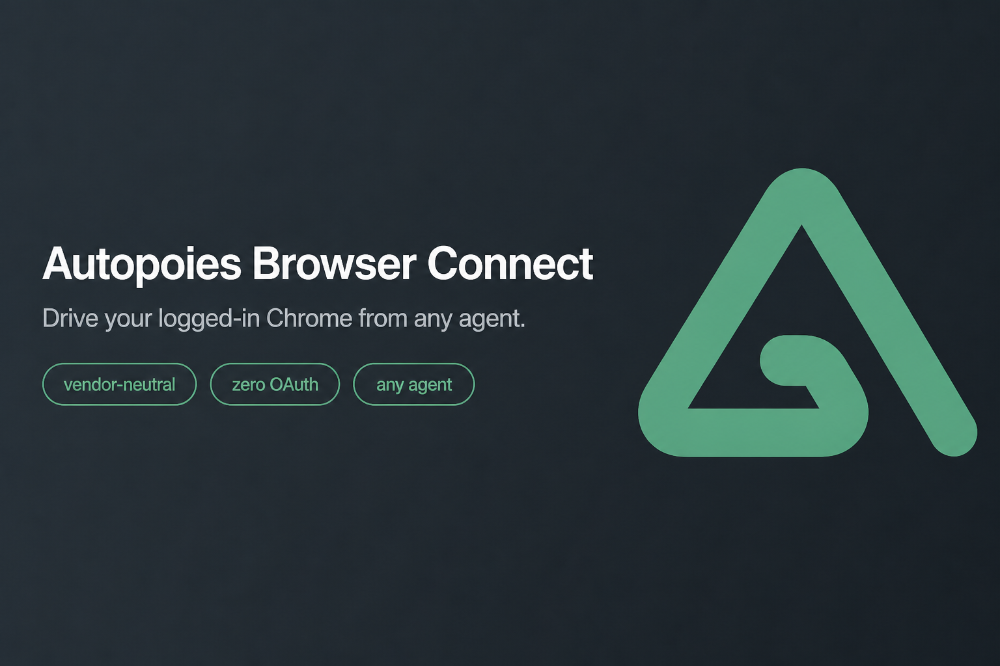
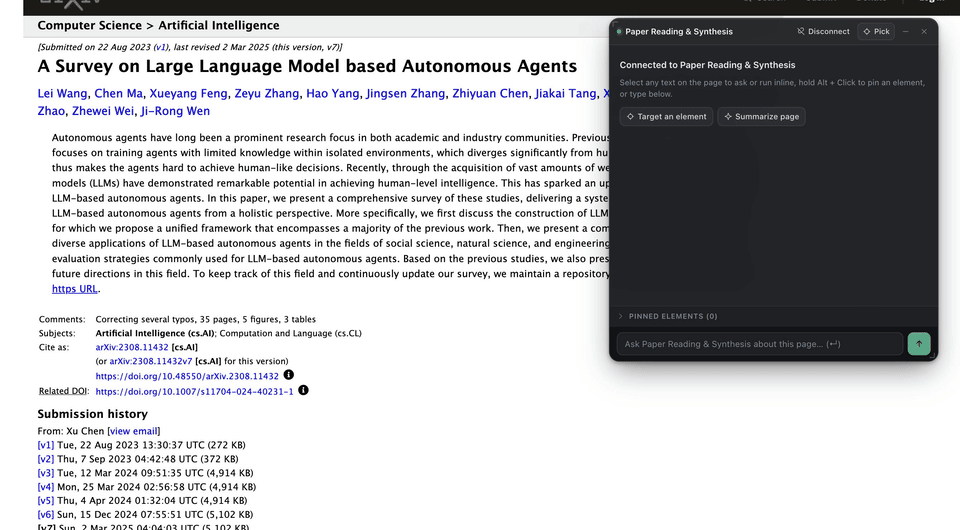
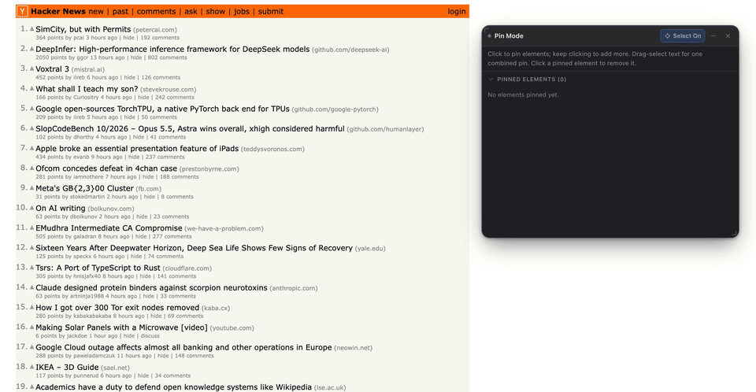
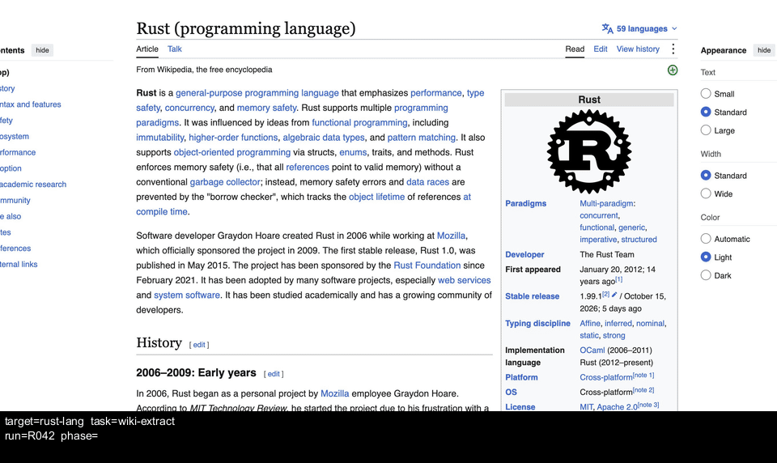
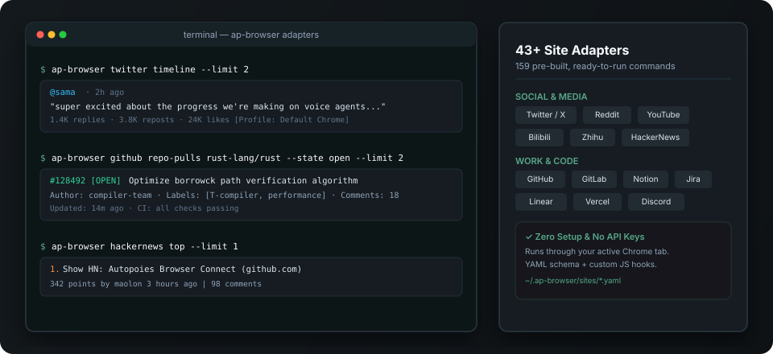
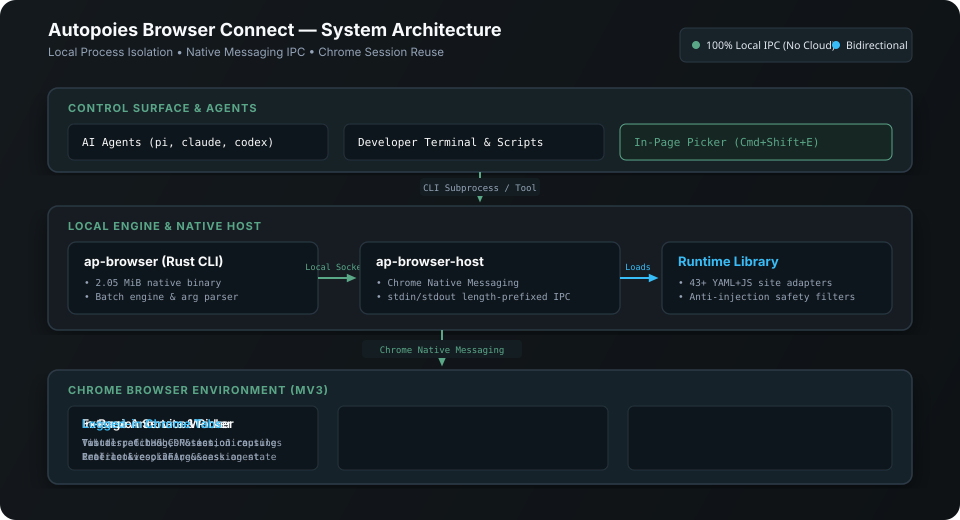

<p align="center">
  <a href="README.md">English</a> · <strong>简体中文</strong> · <a href="https://github.com/autopoies/ap-browser-connect-adapters">站点适配器库 (47 个站点)</a> · <a href="skill/SKILL.md">Agent Skill</a> · <a href="skill/references/commands.md">CLI 命令参考</a>
</p>

<p align="center">
  <strong>让你终端里的编程 Agent，直接连接你已打开的 Chrome。</strong>
</p>
<p align="center">
  支持任意编程 Agent · 现有登录态即插即用 · 47 个站点适配器 · 页内交互 · 视频与 GIF 录制
</p>

<div align="center">

[](https://github.com/autopoies/ap-browser-connect/releases/latest)
[](https://www.npmjs.com/package/ap-browser-connect)
[](LICENSE)
[](https://www.rust-lang.org/)
[](https://developer.chrome.com/docs/extensions/mv3/)
[](https://github.com/autopoies/ap-browser-connect)
[-yellow.svg)](https://github.com/autopoies/ap-browser-connect)

</div>

`ap-browser` 将你日常使用、已登录的 Chrome 直接连接到 **Claude Code**、**Codex**、**Pi**、**Cursor** 和 **OpenCode**。无需启动几百 MB 的无头浏览器，无需导出 Cookie，也不会绑死特定模型——它提供 **2 MiB 的原生 Rust CLI**、覆盖 **47 个主流网站的适配器**、**GIF/MP4 录制工具**，以及在网页内按下 `Cmd+Shift+E` 即可划选文字向终端 Agent 提问的**页内交互**能力。

<p align="center">
  
</p>
<p align="center"><sub>按下 <code>Cmd+Shift+E</code> 划选段落，直接在网页内向终端里的 Agent 提问，执行进度和回答会实时推回页面右下角。</sub></p>

---

## 快速开始

将以下指令发给 **Claude Code**、**Codex**、**Pi**、**Cursor** 或 **OpenCode**：

```text
Install ap-browser: run `npx skills add autopoies/ap-browser-connect/skill` if the skill isn't already installed, then read that skill's `install.md` and follow the 4 steps it describes (release binaries, extension load-unpacked, native manifest, adapters/filters). Verify with `ap-browser ping`.
```

<details>
<summary><strong>手动安装步骤（共 4 步）</strong></summary>

1. **安装 Skill**：`npx skills add autopoies/ap-browser-connect/skill`
2. **安装 CLI**：`npm install -g ap-browser-connect`（或从 [Releases](https://github.com/autopoies/ap-browser-connect/releases/latest) 下载预编译包）
3. **加载 Chrome 扩展**：解压 [Releases](https://github.com/autopoies/ap-browser-connect/releases/latest) 中的 `ap-browser-extension-*.zip`，打开 `chrome://extensions/` 开启**开发者模式**，点击**加载已解压的扩展程序**。
4. **注册通信清单与适配器**：
   ```bash
   curl -fsSL https://raw.githubusercontent.com/autopoies/ap-browser-connect/main/install/install.sh | bash
   git clone https://github.com/autopoies/ap-browser-connect-adapters.git /tmp/abc-adapters
   mkdir -p ~/.ap-browser && cp -R /tmp/abc-adapters/sites /tmp/abc-adapters/filters /tmp/abc-adapters/download-config.yml /tmp/abc-adapters/adapters-version.yml ~/.ap-browser/
   ap-browser ping
   ```

</details>

---

## 为什么选择 ap-browser-connect？

### 人与 Agent 双向协同：终端可调用，网页内可直接对话

其他浏览器工具大多是单向的：要么只给人点击侧边栏，要么只给 Agent 在后台操作。`ap-browser` 打通了双向流程：Agent 可以在终端按数字编号操作页面（`click 12`）；你在网页上按下 `Cmd+Shift+E` 就能圈选元素、划选文字向绑定的终端会话提问，无需在浏览器和终端之间频繁切换窗口。

### 一条命令提取数据，告别反复试探选择器

内置 **47 个常用网站的适配器**（共 196 条命令），覆盖 GitHub、ChatGPT、Gemini、Muse、Gmail、Hacker News、Reddit、X/Twitter、arXiv、Bilibili、知乎等。运行一条 `ap-browser hackernews best --limit 5` 即可返回干净的 JSON（**减少 67% 工具调用，节省 88% Token**）。当你正在浏览其他网页时，适配器会自动在后台打开临时标签页并在完成后关闭。

### 将操作过程录制为 GIF / MP4，自动附带阶段水印

`ap-browser record` 可将页面视口、指定区域或单个元素录制为 **GIF**、**MP4** 或 **MOV**。Agent 在执行任务时可通过 `record phase` 和 `record mark` 向底部信息条实时写入当前阶段与备注，方便验收 UI 或回放多轮调试过程。

### 直接调用日常 Chrome，2 MiB 原生 Rust

通过本地通道直接连接你现有的 Chrome Profile（`Personal`、`Work`），现有的登录状态、SSO、双因素认证即插即用。CLI 单文件仅 **2.05 MiB**（内存占用 <5 MiB，响应耗时 26–47 ms），内置**站点安全过滤规则**，在网页文本发往模型前自动剔除广告与可疑 Prompt 注入节点。

---

## 可以用它做什么

### 浏览网页时直接划词，向终端里的 Agent 提问

对你的编程 Agent 说：

```text
把这个 Chrome 标签页绑定到当前会话，我划选这篇论文的内容直接向你提问。
```

在网页上划选文字（`Cmd+Shift+E`）并点击 **`✦ Ask`**，终端里的 Agent 就会把实时进度和回答推回页面悬浮窗：

```bash
ap-browser --tab 42 bind --inbox /path/to/mailbox/inbox/session-01 --label "Paper Reading & Synthesis"
ap-browser reply --event-id "$EVENT_ID" --status running --message "Reading abstract & extracting the 4-component agent taxonomy..."
ap-browser reply --event-id "$EVENT_ID" --status done --message "The survey structures LLM autonomous agents into **4 core modules**: **1. Profiling**, **2. Memory**, **3. Planning**, and **4. Action**."
```

<p align="center">
  
</p>

---

### 圈选固定页面元素，让 Agent 按编号精准操作

按下 `Cmd+Shift+E`（或运行 `ap-browser dev annotate`）开启 **Pin 模式**：

```bash
ap-browser dev annotate                  # 开启页内圈选模式
ap-browser state                         # 读取页面交互元素 [N] 编号及已固定的元素
ap-browser screenshot --annotate         # 生成带红框 [N] 编号与绿框用户标注的截图
ap-browser click 250                     # 直接按数字编号点击，无需猜测 CSS 选择器
```

<p align="center">
  
</p>
<p align="center"><sub>连续点击固定多条内容，跨元素拖拽生成单条合并文本选区，点击 <strong>Select On / Off</strong> 即可暂停选取并正常浏览网页。</sub></p>

---

### 将执行过程录制为 GIF / MP4，并打上实时阶段水印

```bash
ap-browser record --duration 6s --region 560,60,1360,720 --preset balanced --watermark task --label task=wiki-extract --label target=rust-lang --out ./clips/rust-overview.gif

ap-browser record start --max-duration 25s --region 560,60,1360,720 --label task=wiki-extract --label target=rust-lang --run-id R042
ap-browser record phase "$HANDLE" --text "Phase 1: Extract language overview & infobox"
ap-browser record phase "$HANDLE" --text "Phase 2: Inspect Syntax & code examples"
ap-browser record mark "$HANDLE" --text "Extracted infobox: 14 fields verified" --duration 2.4s
ap-browser record stop "$HANDLE"
ap-browser record export "$HANDLE" --size 960 --fps 8 --watermark task --out ./clips/wiki-rust.gif
ap-browser record release "$HANDLE"
```

<p align="center">
  
</p>

---

### 47 个常用网站，一条命令获取结构化数据



```bash
# 网页版 AI 助手
ap-browser chatgpt send "对比主流 Rust 异步运行时" --wait
ap-browser gemini menus                                # 查看 Gemini 模型列表、思考深度与工具菜单
ap-browser muse chats                                  # 查看 Meta Muse 会话与旁聊

# 代码、论文与邮箱
ap-browser github repo-pulls rust-lang/rust            # 查看仓库 PR 列表
ap-browser gmail search "label:unread" --limit 10      # 搜索、读取、发送或回复 Gmail 邮件
ap-browser arxiv search "browser agent" --limit 10     # 搜索 arXiv 论文
ap-browser google-scholar search "LLM agents"          # 谷歌学术检索与 BibTeX 导出

# 社区、资讯与音视频
ap-browser hackernews top --limit 10                   # Hacker News 首页热门内容
ap-browser reddit subreddit rust --limit 10            # Reddit 版块帖子
ap-browser twitter timeline --limit 20                 # 已登录 X/Twitter 首页时间线
ap-browser bilibili search "Rust"                      # Bilibili 视频搜索
ap-browser zhihu hot                                   # 知乎热榜
```

完整列表见 [ap-browser-connect-adapters](https://github.com/autopoies/ap-browser-connect-adapters)，也可参考 [适配器指南](skill/references/create-site.md) 通过 YAML + JS 扩展新站点。

---

## 与同类项目对比

| | **ap-browser-connect** | 侧边栏浏览器 Agent | 无头浏览器自动化 | 通用 Browser MCP / CLI |
| --- | :-: | :-: | :-: | :-: |
| **直接复用已登录的 Chrome（支持多 Profile）** | ✅ | ✅ | ❌ | ◐ |
| **兼容任意终端编程 Agent（不绑定特定模型）** | ✅ | ◐ | ✅ | ✅ |
| **页内划词/圈选交互 (`Cmd+Shift+E`) + 实时会话悬浮窗** | ✅ | ◐ | ❌ | ❌ |
| **内置 47+ 站点适配器（196 条现成命令，一步到位）** | ✅ | ❌ | ❌ | ❌ |
| **视口 / 区域 / 元素 GIF 与视频录制 + 任务阶段水印** | ✅ | ❌ | ◐ | ❌ |
| **本地 DOM 防注入过滤与危险点击拦截** | ✅ | ❌ | ❌ | ❌ |
| **2 MiB 原生 Rust 单文件，内存 <5 MiB（无 Node/Chromium 常驻）** | ✅ | ❌ | ❌ | ❌ |

<sub>✅ 内置支持 · ◐ 部分支持或需额外配置/编写代码 · ❌ 不支持。</sub>

---

## 常用命令一览

| 分类 | 核心命令 | 功能说明 |
| --- | --- | --- |
| **实时会话协同** | `bind`, `unbind`, `bindings`, `reply` | 绑定本地 Agent 会话，在网页内流式收发执行进度与回答 |
| **页内交互与快照** | `Cmd+Shift+E`, `dev annotate`, `state`, `screenshot --annotate` | 页内固定元素或划选文字；导出带 `[N]` 编号的快照与角标截图 |
| **视频录制与水印** | `record`, `record start/status/stop/export/release`, `record phase/mark/watermark` | 将视口、区域或元素录制为 GIF/MP4/MOV，支持实时任务水印 |
| **站点适配器** | `sites list`, `sites search <q>`, `sites doc <site>`, `<site> <cmd>` | 一条命令调用 47 个网站的 196+ 项操作，后台标签页自动隔离 |
| **页面交互** | `goto`, `click`, `fill`, `select`, `upload`, `press`, `scroll`, `wait`, `tabs` | 按 `[N]` 编号（`click 12`）或选择器点击输入；支持多文件 `upload` |
| **批量与底层接口** | `batch`, `eval`, `cdp` | 一次往返执行多步 JSON；`--raw` 裸输出 JS 结果或调用 CDP |
| **下载与导出** | `text`, `html`, `download [--video]`, `pdf`, `mhtml`, `har`, `media` | 携带 Cookie 下载文件，探测 HLS/DASH 并分段下载，或提取 `yt-dlp` 视频流；导出 PDF/MHTML/HAR |
| **调试与维护** | `dev console/network/errors/perf`, `profiles`, `use`, `doctor`, `update` | 查看控制台/网络/性能指标，切换多 Profile，自检与更新适配器 |

详见 [CLI 命令参考](skill/references/commands.md)、[视频录制指南](skill/references/recording.md)、[会话接收端协议](skill/references/session-receiver.md)、[常见操作范式](skill/references/patterns.md)、[安全策略](skill/references/safety.md) 与 [多 Profile 指南](skill/references/multi-profile.md)。

---

## 架构与常见问题



- **需要在浏览器扩展里配置 API Key 吗？** 不需要。它直接连接你终端里正在使用的编程 Agent，扩展本身不内置大模型。
- **`download --video` 和 `record` 有什么区别？** `download` 通过页面码流/ffmpeg（Vimeo、HLS/DASH）或 `yt-dlp`（其他视频网站）下载原始媒体；对已发现的码流加 `--start 01:29:00 --duration 120` 可只截取两分钟。`record` 将网页实时渲染画面录制为 `GIF`/`MP4`/`MOV`。详见[源码流下载](skill/references/capture-download.md)。
- **会干扰我正在浏览的标签页吗？** 不会。如果你当前不在目标网站，适配器会在后台打开临时标签页，完成后自动关闭。
- **支持哪些系统？** macOS 与 Linux 已完整测试支持；Windows 目前为 **experimental（实验性支持）**。

## 许可证

[Apache-2.0](LICENSE)
